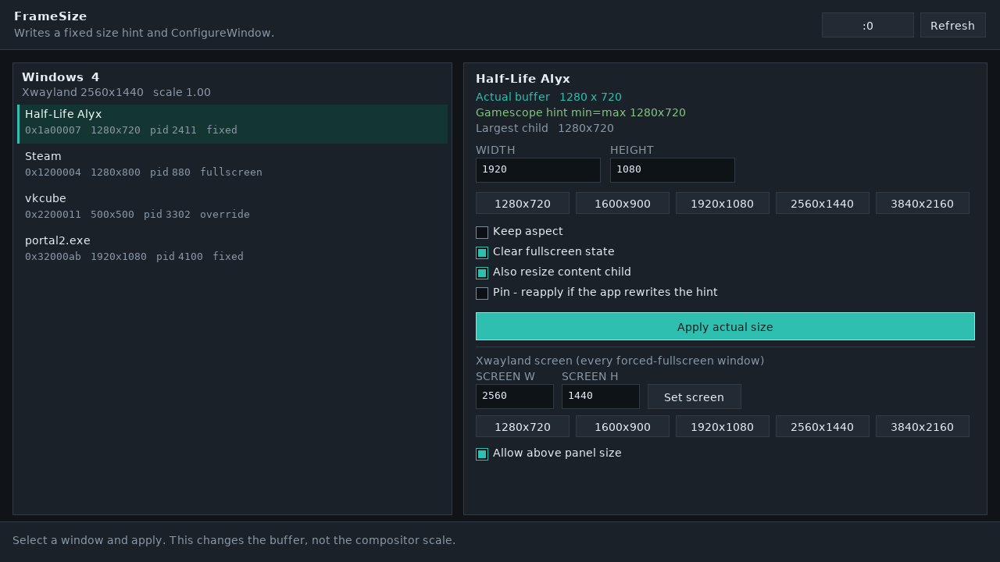

# FrameSize

Sets a window's real buffer size inside Gamescope on the Steam Frame. The window is 1280×720.

## Quick install

On the Steam Frame, in Desktop Mode, from a terminal:

```bash
curl -fsSL https://raw.githubusercontent.com/Skillfur/FrameSize/HEAD/install.sh | bash
```

That downloads the latest static AArch64 build into `~/Applications/FrameSize` and adds an application menu entry. Run it again to update. Start FrameSize from the menu, or add `~/Applications/FrameSize` to Steam as a non-Steam game so Gaming Mode can launch it.

## Gaming Mode

A static AArch64 program with its own 1280×720 window. It drains every pending click before painting, so input does not fall behind the redraw.



## What it sends

- Scans every Gamescope Xwayland socket under `/tmp/.X11-unix`.
- Writes `WM_NORMAL_HINTS` with min = max. That is the size Gamescope keeps as the real buffer.
- Sends `ConfigureWindow`. steamcompmgr applies that as a real resize, which the app receives as `ConfigureNotify`.
- Optionally clears `_NET_WM_STATE_FULLSCREEN`, resizes the content child, and can pin the size if the app rewrites the hint.
- Can also set `GAMESCOPE_XWAYLAND_MODE_CONTROL`, which resizes the whole Xwayland screen rather than one window.

## On the headset

Desktop Mode is only needed for the install. After that, FrameSize talks to the Xwayland display Gamescope already provides.

```bash
~/Applications/FrameSize
~/Applications/FrameSize --list
~/Applications/FrameSize --resize 0xWINDOW 1920 1080
~/Applications/FrameSize --resize-name portal 1920 1080
~/Applications/FrameSize --xwayland 1920 1080
```

Wayland-native clients are not listed. Gamescope does not expose an external resize protocol for them. X11 and Proton windows are.
